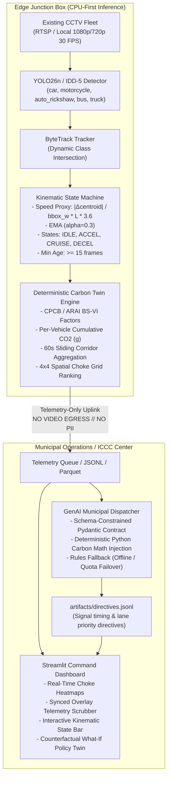

# Eco-Kinetic Traffic Carbon Digital Twin

An edge-native, privacy-preserving carbon footprint intelligence platform for municipal traffic monitoring. By transforming intersection video from existing CCTV enforcement camera fleets into real-time vehicle detections and kinematic state classifications (`IDLE`, `ACCEL`, `CRUISE`, `DECEL`), the system computes deterministic CO2 emissions, evaluates counterfactual what-if scenarios, and generates municipal traffic dispatch directives without ever capturing or processing PII.

---

## 1. System Architecture



---

## 2. Setup & Installation

The repository is built strictly for **CPU-first deployment**, ensuring compatibility with edge boxes and shared ICCC server racks without requiring dedicated GPU infrastructure.

```bash
# 1. Clone the repository and enter the directory
git clone https://github.com/dsu-code-clash/eco-kinetic-twin.git
cd eco-kinetic-twin

# 2. Create and activate a Python 3.10+ virtual environment
python -m venv .venv
source .venv/bin/activate  # On Windows: .venv\Scripts\activate

# 3. Install pinned dependencies (CPU PyTorch)
pip install -r requirements.txt

# 4. Configure environment variables
cp .env.example .env
# Edit .env with your optional GEMINI_API_KEY (defaults gracefully to rules_fallback if omitted)
```

---

## 3. Quickstart & Verification

```bash
# Run full automated test suite (40/40 tests)
python -m pytest -q

# Run end-to-end perception & kinematics pipeline on sample junction video
python scripts/run_pipeline.py --video assets_workspace/junction.mp4

# Benchmark CPU inference performance and generate perf report
python scripts/benchmark.py

# Launch the interactive Streamlit command dashboard
streamlit run dashboard/app.py
```

---

## 4. Methodology & Emission Factors

All carbon calculations are **strictly deterministic in Python**; the LLM is never permitted to calculate emission figures.

### Kinematic State Classification (3-Second Sliding Window)
1. **Speed Proxy ($v_{\text{km/h}}$)**:
   $$v_{\text{bls}} = \frac{|\Delta \text{centroid}_{\text{px}}|}{\text{bbox\_w}_{\text{px}}}$$
   $$v_{\text{km/h}} = v_{\text{bls}} \times \bar{L}_{\text{class}} \times 3.6$$
   Smoothed using Exponential Moving Average (EMA $\alpha = 0.3$).
2. **State Machine Transitions**:
   * **`IDLE`**: $v < 2\text{ km/h}$ for $> 3\text{ s}$ (active only after vehicle previously exceeded $5\text{ km/h}$).
   * **`ACCEL`**: $\frac{dv}{dt} > a_{\text{threshold}}$, or speed climbing from $5 \to 15\text{ km/h}$ within $5\text{ s}$.
   * **`CRUISE`**: Steady corridor velocity between $15\text{--}50\text{ km/h}$.
   * **`DECEL`**: Negative acceleration exceeding stopping threshold.

### Emission Rate Matrix (`config/emission_factors.yaml`)
Derived from empirical CPCB / ARAI / EPA MOVES urban BS-VI driving cycle benchmarks:

| Vehicle Class | Idle Rate ($g/\text{min}$) | Cruise Rate ($g/\text{km}$) | Accel Mult. | Mean Length ($m$) | Regulatory Source & Citation |
| :--- | :---: | :---: | :---: | :---: | :--- |
| **Car** | 22 | 150 | 1.6× | 4.5 | CPCB / ARAI Indian Emission Factors; EPA MOVES3 Urban Baseline (2020) |
| **Motorcycle** | 8 | 80 | 1.4× | 2.0 | CPCB / ARAI Emission Factor Database for Two-Wheelers (2020) |
| **Auto-Rickshaw** | 12 | 95 | 1.4× | 3.0 | ARAI / CPCB Source Apportionment Study for Three-Wheelers (CNG/4S, 2020) |
| **Bus** | 45 | 1000 | 1.8× | 12.0 | CPCB / ARAI Urban Heavy Duty Diesel Transit Bus Emission Factors (2020) |
| **Truck** | 55 | 900 | 2.0× | 10.0 | CPCB / ARAI Goods Transport Fleet Emission Database (2020) |

$$\text{Emission Rate }(g/s) = \begin{cases} 
\frac{\text{idle\_g\_per\_min}}{60} & \text{state} = \text{IDLE} \\
\frac{\text{cruise\_g\_per\_km} \times v_{\text{km/h}}}{3600} & \text{state} \in \{\text{CRUISE}, \text{DECEL}\} \\
\frac{\text{cruise\_g\_per\_km} \times v_{\text{km/h}}}{3600} \times \text{accel\_mult} & \text{state} = \text{ACCEL}
\end{cases}$$

---

## 5. Municipal Dispatcher & Schema Contract

Every 30 twin-seconds (or on severe choke trigger), the system compiles a `CorridorPayload` and issues a structured intervention directive (`Directive`):

```json
{
  "timestamp": "2026-10-16T12:00:00Z",
  "intersection_id": "junction_01",
  "actions": [
    {
      "type": "extend_green",
      "lane": "N",
      "seconds": 12,
      "target_class": null
    }
  ],
  "estimated_co2_saved_g": 65.2,
  "confidence": 0.88,
  "rationale": "Rule Engine: Idle ratio 66.5% and choke zone z_r1_c1 (5.0 idle-veh-min) exceed saturation threshold; granted 12s green extension.",
  "mode": "rules_fallback"
}
```

* **Guardrail Enforcement**: The LLM chooses action types, durations, and audit rationales ($\le 300$ chars) only. Python calculates and injects `estimated_co2_saved_g`.
* **Failover Guarantee**: Out-of-bounds schema or network failure initiates 1 automated retry; if unrecovered, the system seamlessly triggers `rules_fallback` to ensure zero municipal downtime.

---

## 6. Privacy & Edge Compliance

* **Zero-PII Architecture**: License plate reading (ANPR), facial recognition, and pedestrian tracking are architecturally excluded.
* **No Video Egress**: Raw CCTV video streams **never leave the junction processing node**. The communication uplink transmits only lightweight numeric telemetry ($\sim 30.9\text{ KB/min}$) and intervention directives.
* **On-Screen Watermark**: All edge visualization components enforce the compliance status banner:  
  `EDGE INFERENCE // NO VIDEO EGRESS // PII PURGED`

---

## 7. Known Limitations & Edge Cases

1. **Auto-Rickshaw Taxonomy**: Stock COCO weights do not include a dedicated 3-wheeler class (mapping them as `car`). When running stock weights, auto-rickshaws are accounted under car emissions; deploying custom fine-tuned weights (`models/finetuned/best.pt`) unlocks native 5-class detection.
2. **Nighttime & Monsoonal Occlusion**: Extreme low-light conditions or heavy precipitation degrade visual centroid tracking stability. In low-confidence scenarios, the kinematic state machine gates tracks under 15 frames to prevent erroneous state classification.
3. **Monocular Speed Approximation**: Speed is derived from centroid displacement normalized by vehicle bounding box width. Perspective distortion on non-calibrated camera angles can introduce $\pm 10\text{--}15\%$ speed variance, buffered by EMA smoothing.

---

## 8. Deployment Topology

For municipal edge deployment specifications, hardware bill of materials (BOM), ICCC / SCATS / ATCS integration protocols, and cost-benefit analysis, consult [docs/deployment.md](docs/deployment.md).
